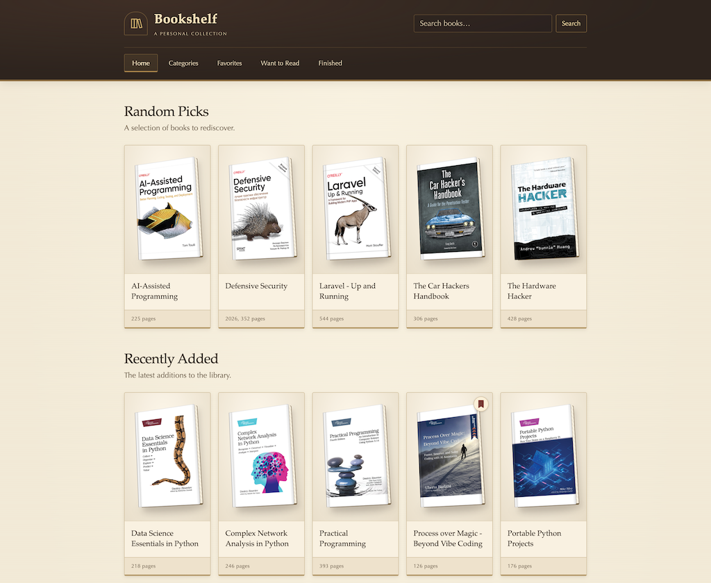

# Bookshelf

[](https://github.com/sibprogrammer/bookshelf/actions/workflows/tests.yml)

A local PDF and EPUB library built with Python, Flask, and Bootstrap. Dependencies are managed with uv.



## Run

Requires Python 3.14 or newer. Install [uv](https://docs.astral.sh/uv/getting-started/installation/), then:

```sh
uv sync --locked
cp config.json.sample config.json
```

Skip the copy if you already have a `config.json`. Edit `books_dir` to point to your book directory, then start the app:

```sh
uv run flask --app src.main run
```

Open <http://127.0.0.1:5000>, go to **Categories**, and click **Reindex** to scan your books directory. Choose a category, then select a book to view its details and open an available format.

Bookshelf is intended for local use. It has no login and opens books in the default reader on the computer running the app.

Use the heart button in a book's details footer to add or remove a favorite. The **Favorites** menu shows your saved books, and favorite books display a heart on their covers throughout the library. Favorites are stored in the database and preserved when reindexing; existing databases are upgraded automatically.

Use the green checkmark button beside the heart to **Mark as read**, or click it again to mark the book as unread. The **Finished** menu shows books you have read, with a green checkmark in a circle at the bottom right of each cover throughout the library. Read status is stored in the database and preserved when reindexing; existing databases are upgraded automatically.

Use the blue bookmark button in a book's details footer to mark it as **Want to Read**, or click it again to remove the mark. The **Want to Read** menu, before **Finished**, shows these books, with a bookmark at the top right of each cover throughout the library. This status is stored in the database and preserved when reindexing; existing databases are upgraded automatically.

## Index behavior

- Scans the configured directory and its subdirectories for PDF and EPUB books.
- Groups files with the same title in the same directory into one book, with both formats available when present.
- Reindexing adds new files, updates existing ones, and removes missing files. A failed scan keeps the previous index.
- EPUB thumbnails use the declared EPUB 2 or EPUB 3 cover image when readable, falling back to the first non-empty page. Reindex to refresh existing thumbnails after a cover extraction update.

## Docker Compose

Place your library in `./books`, or create a `books` symlink to an existing book directory, then run:

```sh
docker compose up --build -d
```

Open <http://127.0.0.1:5000>, then use **Categories → Reindex** to scan the library.

## Development

These commands are useful for development purposes:

```sh
uv sync --locked
uv run pytest
uv run ruff check
uv run ruff format --check
```

